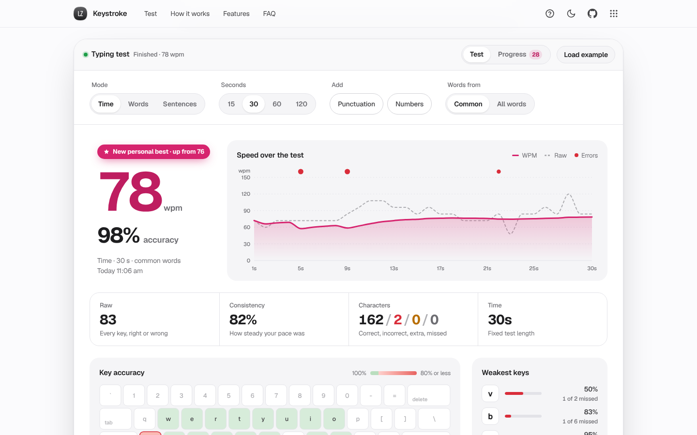

# Keystroke

Type faster. See exactly why. A typing speed test with live WPM, a second-by-second chart, a keyboard heatmap of your weakest keys and drills to fix them.

[](https://lz-keystroke.pages.dev/)

Mirror: https://lazarzec18.github.io/keystroke/



## Features

**Tests**
- Time (15, 30, 60, 120 s), word count (10, 25, 50, 100) and sentence modes (1, 3 or 5 original everyday sentences).
- Options for punctuation, numbers and word difficulty (the 200 most common words, or all 440+).
- Restart at any time with the button or <kbd>Tab</kbd> then <kbd>Enter</kbd>.

**Typing surface**
- Large monospaced text showing three lines that scroll smoothly, with an animated caret.
- Correct, incorrect, extra and missed letters each styled clearly. Backspace works within the current word.
- Live time left, WPM and accuracy. Focus mode fades the rest of the page while you type.
- A hidden input picks up phone on-screen keyboards and autocorrect-style replacements.

**Results**
- Big WPM and accuracy, plus raw WPM, consistency, a correct / incorrect / extra / missed breakdown and time.
- SVG chart of WPM and raw WPM for every second, with error markers and tooltips (mouse, touch or arrow keys).
- Full QWERTY keyboard heatmap of per-key accuracy, with the weakest letters listed.
- "Practise weak keys" builds a 25-word drill from words packed with those letters.
- Repeat the same text, or copy a one-line summary of the result.

**Progress**
- Personal bests for every test length, with a "New personal best" moment when you beat one.
- Averages (last 10 and all time), a WPM-over-time chart with a rolling average and best markers, and a full history.
- Clear history with confirmation. Everything is saved on your device and survives a reload.

## How it works

`engine.js` is a pure, DOM-free typing engine. Every keystroke is stored with a timestamp relative to the first key, and the engine keeps per-key hit and miss counts judged against the key you *should* have pressed (typing past the end of a word counts as a missed space). WPM is **(characters in correctly typed words, including the space after each / 5) / minutes**. A word with an error left in adds nothing. Raw WPM counts every key that produced a character or space, right or wrong. Consistency is 100 x (1 - standard deviation / mean) of the per-second raw speed.

The page never listens for individual letters. It keeps the hidden input's value equal to the current word and turns each change into backspaces, letters and spaces with a small diff. That one path handles desktop keyboards, phone keyboards and autocorrect alike. The caret and three-line scroll are positioned from layout offsets, so CSS transitions animate them without measuring during a transform.

The example data runs a simulated typist with a few weak keys through the real engine, so its chart, heatmap and numbers are genuine output rather than made-up figures.

## Tech

- Vanilla HTML, CSS and JavaScript. No framework, no build step, no runtime dependencies.
- Hand-drawn SVG charts (monotone cubic curves) and keyboard heatmap.
- Zec Labs kit (`zl.css`, `zl.js`) for tokens, components, toasts, dialogs, the guided tour and storage.
- Geist and Geist Mono from Google Fonts. Light and dark themes.

## Run locally

```sh
python3 -m http.server
```

Then open http://localhost:8000.

## Project structure

| File | What it does |
| --- | --- |
| `index.html` | Page structure: hero, the app, how it works, features, FAQ |
| `engine.js` | Typing engine: input handling, results, per-second series, key stats, weak-key drills |
| `words.js` | About 440 everyday words (common and extended pools) and 22 original sentences |
| `app.js` | Wires the engine to the page: tests, rendering, results, progress, tour, example data |
| `charts.js` | SVG line charts with tooltips and the QWERTY heatmap |
| `styles.css` | App styles on top of the kit |
| `zl.css`, `zl.js` | Shared Zec Labs design kit |
| `_headers` | Cloudflare Pages security and cache headers |

## Testing

A Python Playwright suite (87 checks) drives the real page with clicks and key presses:

- A known sequence with a mistake and a backspace correction, typed under a frozen clock, gives exactly 87.5% accuracy, 21 WPM and 24 raw WPM.
- A 15-second test ends on time and its WPM matches the formula; a first result saves a personal best and shows the badge and toast; a slower run does not replace it.
- Tab then Enter and the restart button both restart without saving.
- Typing a wrong letter records a miss for that key in the data, the SVG heatmap and the weakest-keys list; the drill contains only words with those letters.
- Settings, history and personal bests survive a reload; clearing history needs confirmation.
- Phone layout: tapping focuses the hidden input, on-screen and autocorrect input work, inputs are 16px and nothing overflows at 390px.
- Every guided tour step highlights a visible element and the tour completes. No console or page errors.

---

Part of Zec Labs, a set of small, polished web apps by [Lazar Zec](https://github.com/LAZARZEC18). See them all at https://lazarzec.pages.dev/
